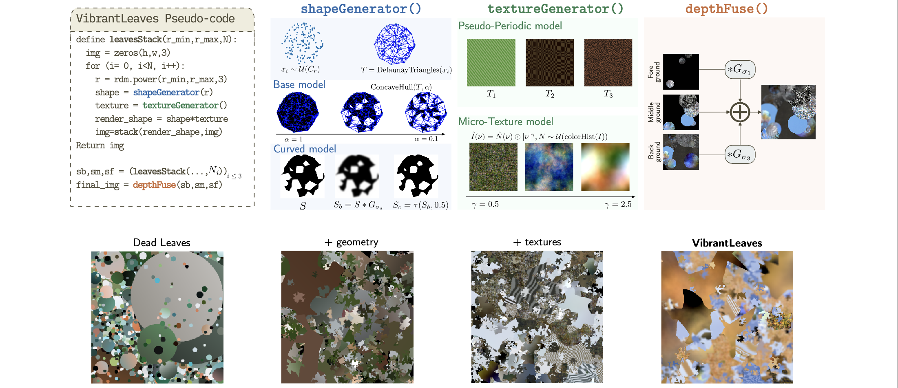

# VibrantLeaves: a principled parametric image generator for training deep restoration models

[Raphael Achddou](https://rachddou.github.io/), [Yann Gousseau](https://perso.telecom-paristech.fr/gousseau/), [Said Ladjal](https://perso.telecom-paristech.fr/ladjal/), [Sabine Susstrunk](https://www.epfl.ch/labs/ivrl/people/susstrunk/)

[](https://arxiv.org/pdf/2504.10201)



VibrantLeaves generates synthetic images for training image restoration networks. It builds on the classical dead leaves model, where random shapes occlude each other, and adds three ingredients:

- **Geometry:** shapes are concave polygons, the concave hull of random points, optionally smoothed.
- **Textures:** pseudo-periodic patterns and 1/f micro-textures, coloured from natural images.
- **Depth of field:** three stacks of shapes (background, middle ground, foreground), with blurred background and foreground.

Denoising and super-resolution networks trained only on these images come close to networks trained on natural images, and are more robust to geometric and radiometric perturbations of the test images.

## What's in this repository

| Path | Contents |
|---|---|
| [`dead_leaves_generation/`](dead_leaves_generation) | The image generator: shapes, textures and depth-of-field composition |
| [`app.py`](app.py) | **Vibrant Leaves Generator**, a web app to explore the parameters and generate datasets |
| [`image_generation.py`](image_generation.py), [`config/default.yaml`](config/default.yaml) | Command-line dataset generation |
| `launcher_train*.py`, [`train_test/`](train_test) | Training of denoising (DRUNet, FFDNet), deblurring and inpainting networks |
| [`launcher_test.py`](launcher_test.py), [`pnp_reconstruction.py`](pnp_reconstruction.py) | Evaluation (denoising, deblurring, inpainting, super-resolution) and DPIR plug-and-play reconstruction |
| [`scripts/compare_with_reference.py`](scripts/compare_with_reference.py) | Checks the generator against its original implementation |

## Installation

Python 3.12 or 3.13 (Hydra 1.3 does not run on Python 3.14):

```
sh setup.sh
```

Shape colours are sampled from natural images; we use the [Waterloo Exploration Database](https://ece.uwaterloo.ca/~k29ma/exploration/).

## Vibrant Leaves Generator app

https://github.com/user-attachments/assets/f6e7f7f1-5ad5-403d-8633-0baee3707fa8

```
python app.py
```

Then open http://127.0.0.1:7860. From the menu you can:

- pick the shape type and the texture types from icons, and set the share of each texture type by dragging the separators of a single bar;
- adjust the leaf size range, the 1/f slope, pattern warps, perspective, colours, depth of field and image size;
- generate a sample of 9 images in a second or two. Seeds are fixed, and each leaf's geometry and fill have their own random streams, so changing a parameter shows its effect on the same images (changing the textures does not move the leaves);
- generate the full dataset of 1000 images with the parameters of the sample. It is saved in `datasets/dataset_<date>_<time>/` with a `config.yaml`, from which `python image_generation.py --config-path <dataset folder> --config-name config` regenerates or extends it. Click the folder path on the page to open it.

Options: `--workers N` (parallel generation processes, 10 by default), `--dataset-dir` (where datasets are saved), `--host` / `--port`. To use it on a remote server, start it there and forward the port: `ssh -L 7860:localhost:7860 <server>`.

## Generating datasets from the command line

```
python image_generation.py color.image_dir=path/to/waterlooDB/
```

Images are saved in `io.path_origin/io.path` (`datasets/vibrant_leaves/` by default). Every parameter of [`config/default.yaml`](config/default.yaml) can be overridden with Hydra's `key=value` syntax. For example, classical dead leaves (disks, flat colours and gradients, no depth of field):

```
python image_generation.py shape.shape_type=disk shape.multiple_shapes=False shape.radius_min=2 \
    texture.enabled=False post_process.depth_of_field=False post_process.blur_type=None \
    post_process.downscale=True io.path=dead_leaves/
```

To generate in parallel, launch several jobs; each one generates `n_images` images (with `seed` set, job `task` uses its own range of seeds):

```
python image_generation.py --multirun task=1,2,3,4 hydra.launcher.n_jobs=4
```

The first run compiles the numba kernels and caches them (a few seconds); run a short generation (`n_images=1`) before launching many jobs at once.

<details>
<summary><code>config/default.yaml</code> (VibrantLeaves settings)</summary>

```yaml
defaults:
  - override hydra/launcher: joblib

shape: ## geometry parameters
  radius_min: 10           # minimum shape radius in pixels (power-law distributed)
  radius_max: 500          # maximum shape radius in pixels
  power_law_exponent: 3.0  # controls size distribution; higher = more small shapes
  shape_type: "poly"       # "poly" | "disk" | "rectangle" | "mix"
  multiple_shapes: True    # randomly switch between "poly" and "mix" each image

task: 1                    # job index, only used to run several jobs with --multirun

texture: ## texture parameters
  enabled: True                     # False = large shapes get colour gradients
  types: ["sin", "freq_noise", "texture_mixes"]
  type_weights: [0.16, 0.67, 0.17]  # sampling probabilities, must sum to 1
  slope_range: [[0.5, 2.5]]         # 1/f^s frequency slope; supports disjoint
                                    # intervals e.g. [[0.5, 1.1], [1.75, 2.4]]
  online_generation: True           # True = generate a texture per shape;
                                    # False = precompute a texture dictionary
  apply_warp: True                  # apply geometric warp to interpolation maps
  texture_path: ""                  # if non-empty, load textures from this dir
  apply_perspective: True           # apply random perspective shift to textures

color: ## color parameters
  use_natural_images: True          # sample colours from real images
  image_dir: "path/to/waterlooDB/"  # directory of source images (required when
                                    # use_natural_images is True)
  grey: False                       # save images as greyscale

io: ## saving parameters
  path_origin: "datasets/"          # images are saved in path_origin/path
  path: "vibrant_leaves/"

post_process: ## depth-of-field and other post-processing
  depth_of_field: True              # composite background/plain/foreground layers
  blur_type: "gaussian"             # "gaussian" | "lens"
  extra_blur: False                 # additional Gaussian blur after DoF compositing
  downscale: True                  # 2x downsample the final image

n_images: 10
seed: null                         # integer = reproducible images (image k uses seed + k)
image_size: 512
image_type: "dead_leaves"          # "dead_leaves" | "textures"
test: False                        # debug: one stack of 15000 shapes, no DoF
```

</details>

In the code, `Deadleaves.compose_dead_leaves_depth_of_field` builds the three layers, `Deadleaves.generate_stack` places the shapes front to back (each new shape only paints the pixels not covered yet), and `Textures.generate_texture` makes the textures. Shapes entirely hidden by closer ones are not generated, which gives the same images in distribution, much faster.

## Datasets

A ready-made VibrantLeaves dataset will be released soon.

## Training

Denoising (DRUNet or FFDNet): extract patches into HDF5 files, then train. Checkpoints and logs go to `TRAINING_LOGS/<log_dir>/`.

```bash
python preprocessing.py --trainset_dir datasets/vibrant_leaves/ --valset_dir datasets/test_sets/Kodak24 \
    --suffix .png --filenames train_vl.h5 val.h5
python launcher_train.py --model DRUNet --filenames train_vl.h5 val.h5 --log_dir drunet_vl
```

Deblurring (Levin09 kernels) and inpainting train directly from image folders:

```bash
python launcher_train_deblur.py --train_dir datasets/vibrant_leaves/ --val_dir datasets/test_sets/Kodak24 \
    --kernel_path datasets/Levin09.mat
python launcher_train_inpaint.py --train_dir datasets/vibrant_leaves/ --val_dir datasets/test_sets/Kodak24
```

Each launcher lists its options with `--help`.

## Evaluation

Pre-trained weights for [denoising, deblurring and inpainting](https://drive.switch.ch/index.php/s/Bmdq0lOHylwgb9d) and [SwinIR super-resolution](https://drive.switch.ch/index.php/s/uCdAIpnKEfE09xJ) (place them under `sr_models/swin_ir_x2/` and `sr_models/swin_ir_x4/`). Put the [test sets](https://drive.switch.ch/index.php/s/jfh3N5ZNv1KVPpP) in `datasets/test_sets/`.

All four tasks use one entry point, `python launcher_test.py --task <denoise|deblur|inpaint|sr> [options]`:

```bash
# Denoising: DRUNet on several test sets and noise levels
python launcher_test.py --task denoise --model_path TRAINING_LOGS/my_model/ckpt.pth \
    --inputs datasets/test_sets/Kodak24 datasets/test_sets/CBSD68 --noise_sigmas 15 25 50 \
    --save_dir denoising/my_model

# Deblurring with Levin09 kernels
python launcher_test.py --task deblur --model_path TRAINING_LOGS/my_deblur_model/ckpt.pth \
    --inputs datasets/test_sets/CBSD68 --kernel_path datasets/Levin09.mat --save_dir deblurring/my_model

# Super-resolution (lightweight SwinIR, x2 or x4)
python launcher_test.py --task sr --scale 2 --model_path sr_models/swin_ir_x2/DL_E.pth \
    --sr_hr_dirs Set5/original Set14/image_SRF_2/HR --sr_names Set5 Set14 --save_dir sr_x2/DL_E
```

For super-resolution, low-resolution images are generated from the ground truth with a MATLAB-equivalent bicubic downsampler (`--sr_lr_dirs` to use existing ones). It relies on [KAIR](https://github.com/cszn/KAIR), a git submodule: run `git submodule update --init --recursive` after cloning.

### DPIR plug-and-play reconstruction

[`pnp_reconstruction.py`](pnp_reconstruction.py) implements DPIR (Zhang et al., 2021) for inpainting and deblurring, with a DRUNet denoiser as prior: half-quadratic splitting with a decreasing noise schedule, using [DeepInverse](https://deepinv.github.io). Inpainting starts from a TV-PGD warm start, deblurring from the pseudo-inverse.

```bash
# Inpainting (30% of the pixels kept)
python pnp_reconstruction.py --task inpainting --inputs Set14/image_SRF_2/HR \
    --model_path models_zoo/drunet_dl.pth --mask 0.3 --save --save_dir pnp_inpainting/drunet_dl

# Deblurring with Levin09 kernels
python pnp_reconstruction.py --task deblurring --inputs Set14/image_SRF_2/HR \
    --model_path models_zoo/drunet_dl.pth --kernel_path datasets/Levin09.mat \
    --noise_sigma 7 --save_dir pnp_deblurring/drunet_dl
```
