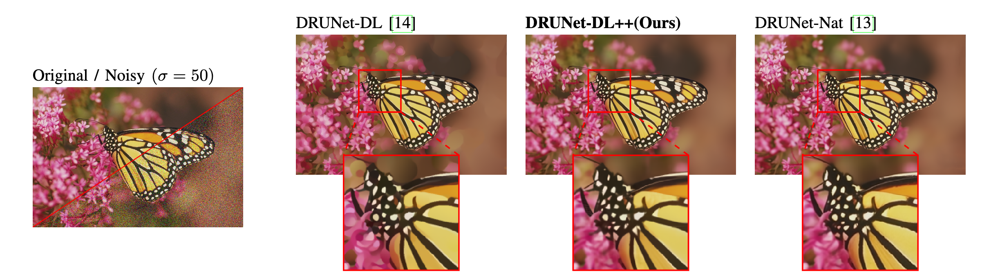
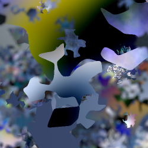
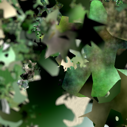
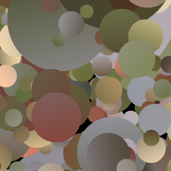
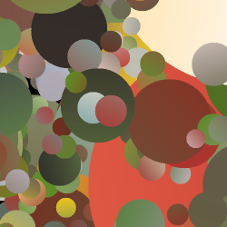

# **VibrantLeaves : A principled parametric image generator for training deep restoration models**

|                                                                                    |
| :------------------------------------------------------------------------------------------------------------------: |
| Image denoising comparison of different versions of DRUNet trained on synthetic images vs real-world natural images. |

**VibrantLeaves : A principled parametric image generator for training deep restoration models**

[Raphael Achddou](https://rachddou.github.io/), [Yann Gousseau](https://perso.telecom-paristech.fr/gousseau/), [Said Ladjal](https://perso.telecom-paristech.fr/ladjal/), [Sabine Susstrunk](https://www.epfl.ch/labs/ivrl/people/susstrunk/)

[](https://arxiv.org/pdf/2504.10201)

## Abstract

Even though Deep Neural Networks (NN) are extremely powerful for image restoration tasks, they have several limitations. They are poorly understood and suffer from strong biases inherited from the training sets. One way to address these shortcomings is to have a better control over the training sets, in particular by using synthetic sets. In this paper, we propose a synthetic image generator relying on a few simple principles. In particular, we focus on geometric modeling, textures, and a simple modeling of image acquisition. These properties, integrated in a classical Dead Leaves model, enable the creation of efficient training sets. Standard image denoising and super-resolution networks can be trained on such datasets, reaching performance almost on par with training on natural image datasets. As a first step towards explainability, we provide a careful analysis of the considered principles, identifying which image properties are necessary to obtain good performances. Besides, such training also yields better robustness to various geometric and radiometric perturbations of the test sets.

|    |    |
| :------------------------------------------------------------------------------: | :--------------------------------------------------------------------: |
|                        **Vibrant Leaves examples**                        |                          Dead Leaves examples                          |

## Usage of this repository

The main contribution here corresponds to the data generation code. We also include training and testing code, which was taken from the original repositories of DRUNet and FFDNet. To generate dead leaves images, we first need to install a few python libraries:

```
sh setup.sh
```

### Data Generation

Generation needs Python 3.12 or 3.13 (Hydra 1.3 does not run on Python 3.14). Set the directory of colour source images (we use the [Waterloo Exploration Database](https://ece.uwaterloo.ca/~k29ma/exploration/)), either in `config/default.yaml` or on the command line, and run:

```
python image_generation.py color.image_dir=path/to/waterlooDB/
```

The images are saved in `io.path_origin/io.path` (`datasets/vibrant_leaves/` by default). Any parameter of `config/default.yaml` can be changed in the file or overridden on the command line with Hydra's `key=value` syntax. For example, classical dead leaves (disks, flat colours and gradients, no depth of field):

```
python image_generation.py shape.shape_type=disk shape.multiple_shapes=False shape.radius_min=2 \
    texture.enabled=False post_process.depth_of_field=False post_process.blur_type=None \
    post_process.downscale=True io.path=dead_leaves/
```

`config/default.yaml` contains the VibrantLeaves settings:

```yaml
defaults:
  - override hydra/launcher: joblib

shape: ## geometry parameters
  radius_min: 10           # minimum shape radius in pixels (power-law distributed)
  radius_max: 500          # maximum shape radius in pixels
  power_law_exponent: 3.0  # controls size distribution; higher = more small shapes
  shape_type: "poly"       # "poly" | "disk" | "rectangle" | "mix"
  multiple_shapes: True    # randomly switch between "poly" and "mix" each image

task: 1                    # job index, only used to run several jobs with --multirun

texture: ## texture parameters
  enabled: True                     # False = large shapes get colour gradients
  types: ["sin", "freq_noise", "texture_mixes"]
  type_weights: [0.16, 0.67, 0.17]  # sampling probabilities, must sum to 1
  slope_range: [[0.5, 2.5]]         # 1/f^s frequency slope; supports disjoint
                                    # intervals e.g. [[0.5, 1.1], [1.75, 2.4]]
  online_generation: True           # True = generate a texture per shape;
                                    # False = precompute a texture dictionary
  apply_warp: True                  # apply geometric warp to interpolation maps
  texture_path: ""                  # if non-empty, load textures from this dir
  apply_perspective: True           # apply random perspective shift to textures

color: ## color parameters
  use_natural_images: True          # sample colours from real images
  image_dir: "path/to/waterlooDB/"  # directory of source images (required when
                                    # use_natural_images is True)
  grey: False                       # save images as greyscale

io: ## saving parameters
  path_origin: "datasets/"          # images are saved in path_origin/path
  path: "vibrant_leaves/"

post_process: ## depth-of-field and other post-processing
  depth_of_field: True              # composite background/plain/foreground layers
  blur_type: "gaussian"             # "gaussian" | "lens"
  extra_blur: False                 # additional Gaussian blur after DoF compositing
  downscale: True                  # 2x downsample the final image

n_images: 10
image_size: 512
image_type: "dead_leaves"          # "dead_leaves" | "textures"
test: False                        # debug: one stack of 15000 shapes, no DoF
```

To generate in parallel, launch several jobs with Hydra's joblib launcher; `task` only distinguishes the jobs, each one generates `n_images` images:

```
python image_generation.py --multirun task=1,2,3,4 hydra.launcher.n_jobs=4
```

The first run compiles the numba kernels and caches them (a few seconds); run one short generation (`n_images=1`) before launching many jobs at once so that they do not all compile them.

#### Interactive app: Vibrant Leaves Generator

`app.py` is a small web app to explore the parameters and build a dataset. Pick the shape type and the texture types from icons, set the proportion of each texture type on a [0, 1] bar, adjust the radius range, depth of field, image size..., and generate a sample of 9 images. Once you are happy with the sample, "Generate full dataset" (after a confirmation) generates 1000 images with the same parameters.

```
python app.py
```

Then open http://127.0.0.1:7860 in a browser. The menu starts from `config/default.yaml`, and images are generated in parallel (`--workers N`, 10 by default) with the same code as `image_generation.py`. Datasets are saved in a new folder `datasets/dataset_<date>_<time>/` (`--dataset-dir` to change it), together with a `config.yaml` of the parameters, which can be reused with `python image_generation.py --config-path <dataset folder> --config-name config`. Click the folder path shown on the page to open it in your file manager (macOS, Windows and Linux; when the app runs on a remote server, the path is copied to the clipboard instead). The generation goes on if the page is closed, and its progress shows again when the page is reopened. To run the app on a remote server, start it there and forward the port: `ssh -L 7860:localhost:7860 <server>`.

#### How the generator works

An image is the composition of three layers of "leaves" (`Deadleaves.compose_dead_leaves_depth_of_field`): a blurred background, an in-focus middle layer and a blurred foreground. Each layer is a stack of shapes (polygons, disks or rectangles) whose radii follow a power law between `radius_min` and `radius_max` (`Deadleaves.generate_stack`). Shapes are placed front to back: each new shape only paints the pixels that are not covered yet. Small shapes get a flat colour picked in a source image; larger ones get a colour gradient or a texture (sinusoidal patterns, coloured 1/f noise or mixes of both, optionally warped and seen in perspective).

Shapes that end up entirely hidden behind previously placed shapes do not change the image, so they are not generated (`skip_hidden=True`, the default); this gives the same images, in distribution, much faster. `scripts/compare_with_reference.py` checks the generator against the original implementation.

### Datasets

If you don't want to bother with launching data generation, here's a link to download the dataset: [UNRELEASED(WIP)]()

### Training

Once the images are generated, you can run the command `.jobs/train.sh`

This will create a directory where the weights are stored inside `TRAINING_LOGS/`

### Testing

All four restoration tasks — **denoising**, **deblurring**, **inpainting**, and **super-resolution** — are evaluated through a single entry point:

```bash
python launcher_test.py --task <denoise|deblur|inpaint|sr> [options]
```

Pre-trained weights for denoising, deblurring and inpainting are available [here](https://drive.switch.ch/index.php/s/Bmdq0lOHylwgb9d). Download the [testsets](https://drive.switch.ch/index.php/s/jfh3N5ZNv1KVPpP) and place them in the `datasets/test_sets/` folder.

Pre-trained SwinIR weights for super-resolution are available [here](https://drive.switch.ch/index.php/s/uCdAIpnKEfE09xJ); place them under `sr_models/swin_ir_x2/` and `sr_models/swin_ir_x4/`.

**Denoising** — evaluate a DRUNet model on one or several datasets at multiple noise levels:

```bash
python launcher_test.py --task denoise \
    --model_path TRAINING_LOGS/my_model/ckpt.pth \
    --inputs datasets/test_sets/Kodak24 datasets/test_sets/CBSD68 \
    --noise_sigmas 15 25 50 \
    --save_dir denoising/my_model
```

**Deblurring** — evaluate on a set of images using Levin09 blur kernels:

```bash
python launcher_test.py --task deblur \
    --model_path TRAINING_LOGS/my_deblur_model/ckpt.pth \
    --inputs datasets/test_sets/CBSD68 \
    --kernel_path datasets/Levin09.mat \
    --save_dir deblurring/my_model
```

**Super-resolution** — evaluate a lightweight SwinIR model at scale ×2 or ×4. LR images are generated on-the-fly from the HR ground truth using a MATLAB-equivalent bicubic downsampler. SR evaluation uses [KAIR](https://github.com/cszn/KAIR) (included as a git submodule); initialise it after cloning with `git submodule update --init --recursive`.

```bash
python launcher_test.py --task sr \
    --scale 2 \
    --model_path sr_models/swin_ir_x2/DL_E.pth \
    --sr_hr_dirs Set5/original Set14/image_SRF_2/HR \
    --sr_names   Set5          Set14 \
    --save_dir   sr_x2/DL_E
```

To use pre-existing LR images instead of generating them on-the-fly, pass `--sr_lr_dirs` alongside `--sr_hr_dirs`.

### DPIR Plug-and-Play reconstruction

`pnp_reconstruction.py` implements the **DPIR** algorithm (Zhang et al., 2021) for inpainting and deblurring using a DRUNet denoiser as an implicit prior. DPIR uses Half-Quadratic Splitting (HQS) with a log-spaced decreasing noise schedule, driven by [DeepInverse](https://deepinv.github.io).

For inpainting a TV-PGD warm start is computed first, then passed as initialisation to HQS. For deblurring the HQS solver is run directly from the pseudo-inverse.

```bash
# Inpainting (30% pixels kept)
python pnp_reconstruction.py \
    --task inpainting \
    --inputs Set14/image_SRF_2/HR \
    --model_path models_zoo/drunet_dl.pth \
    --mask 0.3 --save --save_dir pnp_inpainting/drunet_dl

# Deblurring with Levin09 kernels
python pnp_reconstruction.py \
    --task deblurring \
    --inputs Set14/image_SRF_2/HR \
    --model_path models_zoo/drunet_dl.pth \
    --kernel_path datasets/Levin09.mat \
    --noise_sigma 7 --save_dir pnp_deblurring/drunet_dl
```

